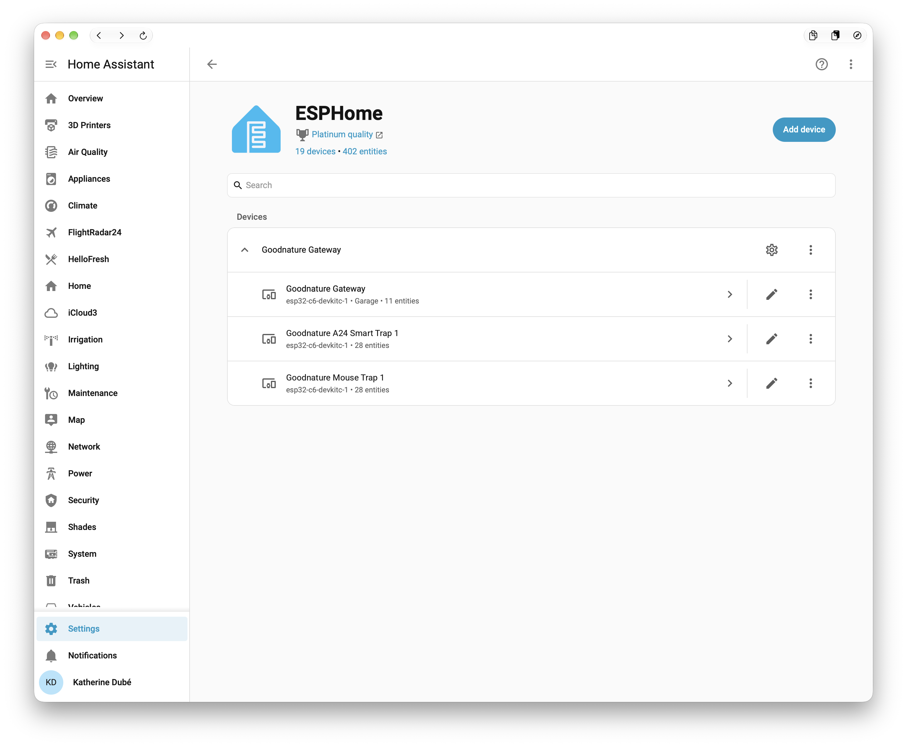
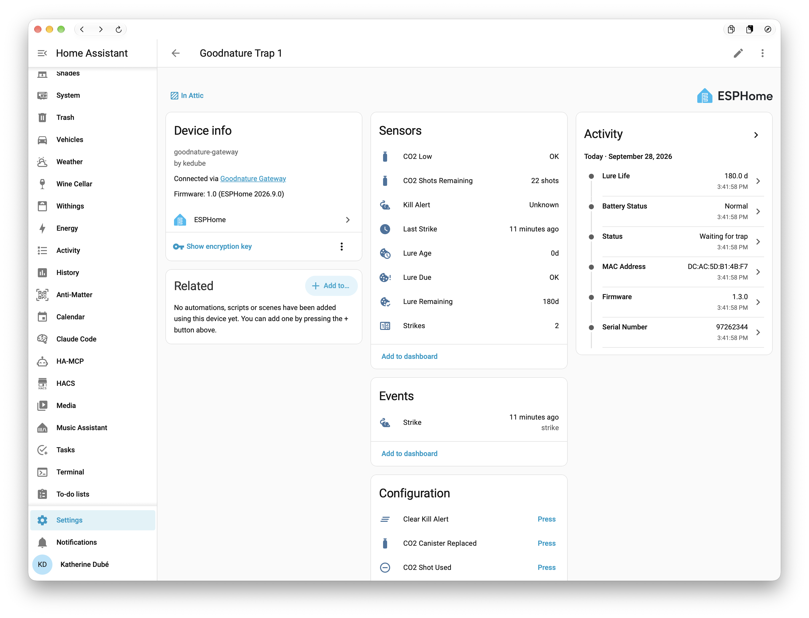
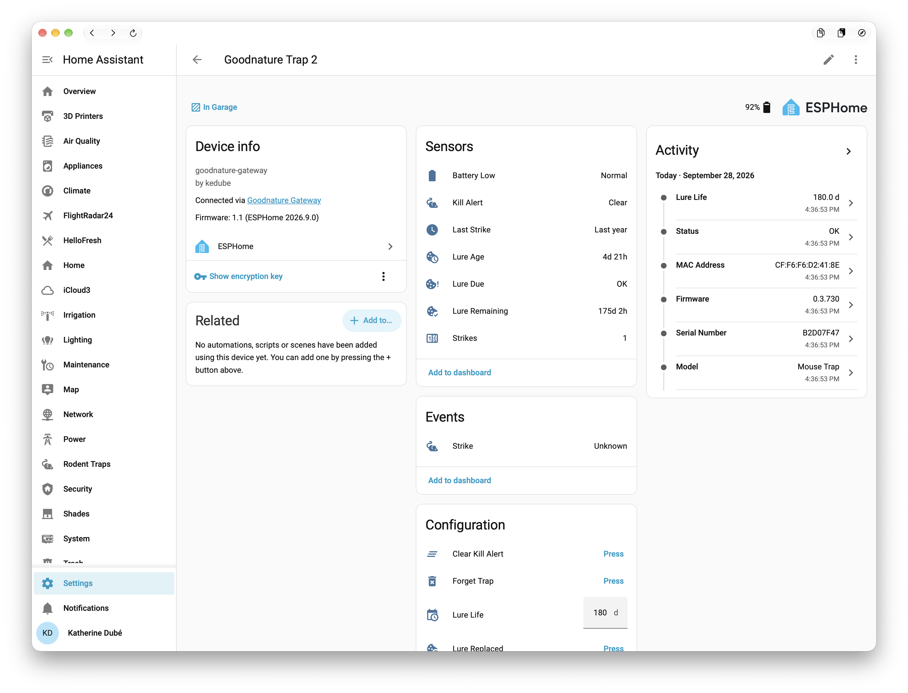
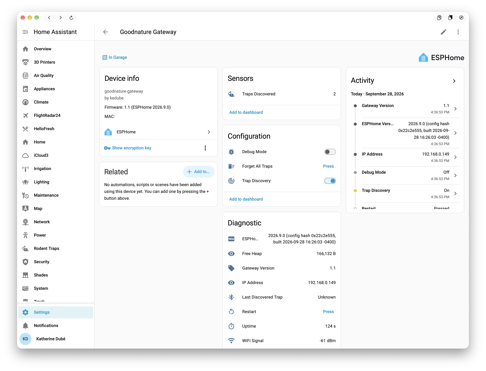

# ESPHome Goodnature BLE Gateway

Monitor [Goodnature](https://goodnature.co.nz) A24 Smart Traps and Mouse Traps in Home Assistant with an ESP32-C6 or ESP32-S3 running [ESPHome](https://esphome.io). Put the gateway near your traps and it discovers them, tracks strikes, battery and consumables, and exposes **each trap as its own Home Assistant device**. Fully local: no cloud, no app.

> **Status: experimental.** The protocol layer is ported from the
> [ha-goodnature](https://github.com/codyc1515/ha-goodnature) integration and
> covered by host-side unit tests, but the gateway has had little time against
> real traps and no real kill has been observed through it yet. Issues with
> debug captures are welcome.

## How it works

Goodnature traps use Bluetooth Low Energy. This project reimplements the app's protocol as a native ESPHome component: one **hub** owns a fixed number of **trap slots**, and every slot holding a trap is a Home Assistant sub-device.

- **Discovery.** The hub recognises Goodnature traps from their advertisements and binds each to the first free slot. Bindings are stored in flash, so a trap keeps its device across reboots. A Mouse Trap is tracked by the serial in its advertisement, an A24 by its Bluetooth address.
- **Two families.** The **A24** (CO2-powered rat and stoat trap) sleeps, advertises in a burst when it fires, and uses Goodnature's original GATT services. The rechargeable **Mouse Trap** ("C20" in the protocol notes) advertises continuously and talks over a Nordic UART service. The **Model** sensor shows which a slot holds.
- **Passive, then active.** Strikes are picked up from advertisements without connecting. On a schedule (default 15 min), after a strike, or on a button press, the gateway connects over GATT to sync the trap's clock and read counters, battery and identity. An A24 can only be reached while awake, so its polls happen when it is heard.
- **Consumables.** Lure life and CO2 shots are not available over BLE, so the gateway keeps its own timers, reset with the **Lure Replaced** and **CO2 Canister Replaced** buttons.

## Requirements

- **ESP32-C6 or ESP32-S3** board. `settings.yaml` has a ready-made block for each; the default is `esp32-c6-devkitc-1`. Both have been run on hardware. Other BLE-capable ESP32s should work by setting `board`, `variant`, `flash_size` and `partitions` to match.
- **ESPHome 2025.12.0 or newer.** The YAML sets `min_version: 2025.12.0` and older versions refuse to build. Developed against 2026.8.
- **Home Assistant 2025.6 or newer** with the ESPHome integration, so sub-devices appear as separate devices.

## Getting started

### 1. Install ESPHome

```bash
python3 -m venv esphome-venv
source esphome-venv/bin/activate
pip install esphome
esphome version   # 2025.12.0 or newer
```

### 2. Configure

```bash
cp settings-example.yaml settings.yaml   # tunables: name, board, slots, poll interval, lure life, CO2 size, ports
cp secrets-example.yaml secrets.yaml     # Wi-Fi, API key, OTA password, fallback hotspot
```

`goodnature-gateway.yaml` is the complete configuration and needs no editing. Both files above are git-ignored. To build the component from git instead of the local checkout, swap the `external_components` source for the commented-out `github://` line.

### 3. Flash

Set `upload_port` in `settings.yaml` (for example `/dev/cu.usbmodem1101` on macOS or `/dev/ttyACM0` on Linux), then:

```bash
make flash          # compile and flash over USB
make logs-serial    # follow the log over USB
make ota            # later: update over the air to ota_address
make logs           # follow the log over the network
```

The Makefile only adds `--device` to `esphome run`, so calling ESPHome directly works too. `upload_speed` and `ota_address` (default `<device_name>.local`; use the IP if mDNS is unreliable) also live in `settings.yaml`.

**Board choice.** The hardware block in `settings.yaml` sets `board`, `variant`, `flash_size` and `partitions` together; uncomment the block for your board and comment out the other. The four values must agree, so check your board's real flash size.

| Board | `variant` | `flash_size` | `partitions` |
|---|---|---|---|
| ESP32-C6 DevKitC-1 (default) | `esp32c6` | `4MB` | `partitions.csv` |
| ESP32-S3, 4 MB | `esp32s3` | `4MB` | `partitions.csv` |
| ESP32-S3-DevKitC-1-N8, 8 MB | `esp32s3` | `8MB` | `partitions-8mb.csv` |

The project ships its own partition tables because the firmware is large: `partitions.csv` gives 1.94 MB app slots on 4 MB flash, `partitions-8mb.csv` gives 3.94 MB on 8 MB. Partition tables only change on a USB flash, and the first flash with one moves the settings area, so the gateway forgets its traps once.

### 4. Add to Home Assistant

Accept the discovered gateway under **Settings → Devices & Services** and enter the API encryption key from `secrets.yaml`. You get one gateway device plus one device per slot in use, named after the trap it holds and numbered per model: **Goodnature A24 Smart Trap 1, 2, …** and **Goodnature Mouse Trap 1, 2, …**. A fresh gateway shows a single empty slot, **Goodnature Trap 1**; each newly discovered trap takes the next slot, and the gateway restarts a few seconds later so Home Assistant gains the device under its model name.



### 5. Deploy

Power the gateway near the traps. When one advertises, the log shows

```
[I][goodnature_ble] Discovered Goodnature A24 at C0:FF:EE:12:34:56 (RSSI -71), assigned to slot 1
```

and the slot fills in. Rename the device in Home Assistant; the name is kept. A trap keeps its slot until you press **Forget Trap**. A sleeping A24 is not seen until it fires or is woken (shake it, or open the app nearby).

## Configuration

Every option is a substitution in `settings.yaml`, passed through to the `goodnature_ble:` block in the gateway YAML.

| Option | Default | Effect |
|---|---|---|
| `max_traps` | `8` | Number of slots compiled in (~28 entities each). Only slots holding a trap are shown in Home Assistant. |
| `slot_name_prefix` | `Goodnature Trap` | Name for a slot whose model is not known yet, as `<prefix> <slot>`. Traps are named after their model. |
| `poll_interval` | `15min` | Minimum time between GATT polls of a trap. `0s` disables scheduled polling. |
| `lure_life_days` | `180` | Default A24 paste life, as in the app; each trap has a **Lure Life** number to override it. The Mouse Trap's donut defaults to 90 days (`mouse_trap_lure_life_days`). |
| `co2_capacity` | `24` | Shots per CO2 canister (A24). Like the app, one shot is also counted lost every 21 days the canister is in (`co2_leak_days`). |
| `co2_low_threshold` | `4` | **CO2 Low** turns on at or below this many shots. |
| `offline_timeout_c20` | `15min` | **Online** turns off when a Mouse Trap has not been heard for this long. A24s have no timeout; see **Online**. |
| `write_time_on_connect` | `true` | Send the current time to the trap on each connection, as the app does. |
| `discovery` | `true` | Initial state of the **Trap Discovery** switch. |
| `auto_acknowledge` | `false` | Mouse Trap: queue **Clear Kill Alert** automatically after a poll finds the alert raised. Home Assistant still sees the alert and **Strike** event first. (An A24 is acknowledged on the trap in every session regardless; its **Kill Alert** stays on until you clear it.) |
| `a24_battery_empty_raw`, `a24_battery_full_raw` | `0`, `0` | Raw A24 battery bytes (`volts / 3.6 × 255`) for flat and fresh batteries, once known, for an A24 **Battery** percentage the app does not have. `0/0` disables it. |
| `a24_battery_low_percent` | `15` | **Battery Low** threshold for the calibrated A24 percentage. |
| `a24_hint_mac`, `a24_hint_serial`, `a24_hint_firmware` | empty | Optional identity fallback for one A24; only the matching MAC uses it, and live BLE reads update the values. |

Set only in the gateway YAML: `time_id` (a `time:` component, needed for lure timers, timestamps, clock sync and the date pickers), `hub_entities` (create the gateway-level entities), `mouse_trap_lure_life_days` (default `90`) and `co2_leak_days` (default `21`, `0` turns the CO₂ ageing off). `settings.yaml` also carries `device_name`, `friendly_name`, `device_description`, `device_area`, `board`, `flash_size`, `upload_port`, `upload_speed`, `ota_address`, `log_level` and `ble_max_connections`.

The component needs `esp32_ble_tracker` and reserves one connection slot in `esp32_ble`. `bluetooth_proxy` can run alongside if you leave it a slot.

## Entities

### Per trap

Each slot in use is a sub-device. A free slot carries the full entity set; once a trap is bound, the next restart registers only the entities for its model. The gateway restarts itself a few seconds after a slot's model changes or a slot comes into or out of use.

Lure and CO2 timers start when a trap is discovered, on the assumption it was just serviced. If not, set **Lure Replaced On** and **CO2 Replaced On** to the real dates, or press the "Replaced" buttons when you next service the trap.




#### Both models

| Entity | Type | Notes |
|---|---|---|
| **Strikes** | sensor, total increasing | A24: the `D20D` counter (test fires included, as they use CO₂); until first read, inferred from advertisement bursts on firmware without the newer advertisement. Mouse Trap: the trap's kill history (its last ten kill times), as the app counts it; each poll adds kills newer than the last one counted. The lifetime total comes from replaying the striker log when a trap is first found and on **Poll Now**; only sensor-triggered fires count, not test fires or the motor's self-tests. |
| **Kill Alert** | binary, occupancy | A24: kept by the gateway. On when **Strikes** goes up, when the trap has kills nobody acknowledged, or when its advertisement shows unread kills; off only when you press **Clear Kill Alert**, and kept across restarts. Starts off at the first session that finds nothing pending (unknown until then). Mouse Trap: the trap's kill state from the poll, or the advertisement's "strikes available" bit when it changes, whichever is newer. |
| **Strike** | event | `strike` when the count goes up, `test_fire` on a Mouse Trap test fire (an A24 fired by hand is a `strike`). Use this for automations. |
| **Last Strike** | text, timestamp | A24: the newest kill record's time, to the minute. Mouse Trap: the trap's own timestamp on its last kill. Test fires do not move it. |
| **Battery** | sensor, % | A24: registered only with the `a24_battery_*_raw` calibration. Mouse Trap: from each poll; kept across restarts. |
| **Battery Low** | binary, battery | The trap's own low-battery flag in its advertisement. Mouse Trap: also at 20 % or below, the app's low-battery threshold. A24: also at or below `a24_battery_low_percent` with the calibration; the flag is kept across restarts. |
| **Battery Status** | text, diagnostic | The app's label. A24: `Full`, `Medium`, `Low` or `Critical` from the battery's internal resistance, kept across restarts (an early capture read `Critical` from a working battery, while two traps later read `Full`, so treat it as a trend). Mouse Trap: `Charging`, `Charged` (plugged in, done), or by level `Full` (85 %+), `Good` (45 %+), `Ok` (15 %+), `Low` (5 %+), `Empty`. |
| **Trap Error** | binary, problem | Mouse Trap: the device state is ERROR; the app's advice is to restart the trap by holding its button until it flashes white. A24: on when the trap logs an error record other than the one it logs whenever it hangs up on the end of a session, and kept, across restarts, until **Clear Trap Error**. |
| **Lure Age**, **Lure Remaining** | sensor, days | From the lure replacement date and **Lure Life**. |
| **Lure Due** | binary, problem | On when Lure Remaining ≤ 0. |
| **Online** | binary, connectivity | A24: on once the trap has checked in, until it is forgotten. An A24 advertises when switched on, after a kill and when shaken, and sleeps in between, so not hearing it is normal. Mouse Trap: heard within `offline_timeout_c20`. |
| **Signal Strength**, **Last Seen** | sensor and text timestamp, diagnostic | Republished at most every 30 s. |
| **Model**, **Serial Number**, **Firmware**, **MAC Address**, **Status** | text, diagnostic | Status: `Unassigned`, `Discovered`, `Waiting for trap`, `Connecting`, `OK`, `Test fire sent`, `Test fire blocked: …`, `Alert cleared`, `Test fire sent; poll failed: …`, `Clear sent; poll failed: …` (the command reached the trap but the poll after it did not finish), `Failed: …`. |
| **Last Advertisement**, **Last Frame** | text, diagnostic, disabled | Raw hex captures, filled only while **Debug Mode** is on. |
| **Lure Life** | number, days | Per-trap override of the default lure life (180 days A24 paste, 90 Mouse Trap donut). |
| **Lure Replaced On** | date, config | The lure replacement date. Set a past date if you replaced it earlier; today means now. Future dates are refused. |
| **Poll Now** | button | Connect and read everything. On a Mouse Trap also replays the whole striker log (about 12 s) to resync **Strikes** with the trap's lifetime total. |
| **Lure Replaced** | button | Restarts the lure timer now. |
| **Clear Trap Error** | button | A24 only: turns **Trap Error** off. |
| **Clear Kill Alert** | button | A24: turns **Kill Alert** off at once, without the trap: the gateway already acknowledges kills on the trap in every session, like the app. Mouse Trap: `SetCommand(CLEAR)` (the app's "Empty trap"), sent even when the trap refuses UART notifications, and not resent once the trap acknowledges it. |
| **Test Fire** | button | Mouse Trap only. **Fires the trap**: `SetCommand(FIRE)`, refused (Status `Test fire blocked: …`) while the trap is on the charger, has a kill waiting, has its tray open, is in error, or before its first poll, as in the app. Once the trap acknowledges the write it is not resent, even if the poll after it fails. An A24 has no **Test Fire**: its Smart Cap only counts strikes, so test fire it by hand with a stick on the trigger, as the app says. |
| **Forget Trap** | button | Unbind the slot so it can take a new trap. |
| **Log Debug Info** | button | Dump the slot's internal state to the log at INFO. |

#### A24 only

| Entity | Type | Notes |
|---|---|---|
| **Battery Voltage** | sensor, V, diagnostic | From the advertisement or `FAD1`: raw ÷ 255 × 3.6 V, as the app reads it. Kept across restarts. |
| **Battery Internal Resistance** | sensor, diagnostic, disabled | Raw reading behind **Battery Status**; units unknown. Kept across restarts. |
| **Last Strike Temperature** | sensor, °C | Air temperature in the newest kill record. Kept across restarts. |
| **CO2 Shots Remaining** | sensor | `co2_capacity` minus strikes since **CO2 Canister Replaced**, minus one per `co2_leak_days` in the trap, as the app counts. |
| **CO2 Low** | binary, problem | On at or below `co2_low_threshold`. |
| **CO2 Replaced On** | date, config | The canister replacement date. Setting it re-anchors the shot count at the current **Strikes** (the gateway has no per-strike history to count from an earlier day). |
| **CO2 Canister Replaced** | button | Re-anchors the shot counter now. |
| **CO2 Shot Used** | button | Subtracts one from shots remaining when the app knows about a shot taken before the gateway anchored its counter. |
| **Last Error Data** | text, diagnostic, disabled | Raw hex of the error record (`E772`), which the app never reads, for decoding. |

#### Mouse Trap only

| Entity | Type | Notes |
|---|---|---|
| **Trap State** | text | The app's status, highest first: `Error`, `Charging`, `Charged` (plugged in, not charging: unplug it to set it), `New strike`, `Tray open` (close it to set it), `Set`. |
| **Armed** | binary, diagnostic | On when the trap is activated and **Trap State** is `Set`: ready to catch. Kept across restarts. |
| **Charging** | binary, diagnostic | Charging state from the poll; kept across restarts. |
| **Peak Fire Current**, **Peak Rewind Current** | sensor, mA, diagnostic | Motor currents of the last fire the gateway saw: a kill (read from the log once **Strikes** goes up) or a test fire. A rising fire current or a falling rewind current may point at a worn or jammed striker. |
| **Inner / Outer Sensor Reading**, **Ambient**, **Threshold** | sensor, diagnostic, disabled | The two infrared sensors' readings for the last kill's trigger event: the reading that triggered, the ambient level, and the threshold. Units unknown. Useful for false triggers or misses. |
| **Battery Recovery Needed** | binary, problem | On when the trap is plugged in, not charging, and reads 0 %: the state the Goodnature app offers battery recovery for. See [Mouse Trap battery recovery](#mouse-trap-battery-recovery). |
| **Bootloader** | text, diagnostic | Bootloader version from each poll (firmware 0.3.730). Battery recovery needs `2.0.0` or later. |

#### Mouse Trap battery recovery

Firmware 0.3.730 with bootloader 2.0.0 (both installed by Goodnature app 3.6.1 or later, the bootloader as a "second update") can recover a battery that will not charge. Nothing over Bluetooth starts it; the trap runs it once, at power-up on USB power:

1. With the trap on its USB charger, unplug it, wait 5 seconds, and plug it back in.
2. Wait for the light to pulse white and pink. It can take up to about 5 minutes.
3. If it flashes once and turns off, or stops pulsing, repeat.

The app takes **Charging** turning on as recovery under way, and **Battery** above 0 % as success; **Battery Recovery Needed** then turns off. The trap marks its battery as recovered and does not run the process again. If **Bootloader** shows `1.0.0`, update the trap with the Goodnature app first: older bootloaders skip recovery. Details are in [docs/ble-protocol.md](docs/ble-protocol.md#battery-recovery-firmware-03730-with-bootloader-200).

### Gateway



| Entity | Notes |
|---|---|
| **Traps Discovered** | Slots in use; the gateway registers this many trap devices (at least one). |
| **Last Discovered Trap** | MAC of the most recently bound trap. |
| **Trap Discovery** | Switch. Turn off once your traps are bound so a neighbour's trap cannot take a slot. Restored across reboots. |
| **Debug Mode** | Switch, off by default. Logs every Goodnature-like advertisement with raw bytes at INFO (one per device per 10 s), dumps the GATT table on every connection, and fills the raw capture text sensors. |
| **Forget All Traps** | Button. Unbinds every slot. |
| **Gateway Version** | Text, diagnostic. Release version of this firmware, also shown as the device's firmware version. |

Plus the usual Wi-Fi, uptime, free heap, ESPHome version and restart entities.

## Debugging and protocol work

`tools/gateway_inspect.py` talks to the gateway over the native API, so no serial cable is needed:

```bash
make states                      # every entity, grouped by device
make capture                     # Debug Mode on for 60 s: decoded advertisements, GATT tables, UART frames
make capture SECONDS=180 POLL=1  # longer, and press Poll Now on every slot first
tools/gateway_inspect.py decode "UART 10/01:e46cb26a01000104000000000000"   # decode a pasted value offline
tools/gateway_inspect.py press "Test Fire" --device "Goodnature Mouse Trap 1" # any button, by name
```

`capture` prints each raw advertisement and frame with a decoded `->` line, using the same layouts as `protocol.cpp`. Bytes not understood yet (5 and 8 of the Mouse Trap advertisement) are shown raw, and the gateway logs `advertisement bytes changed` whenever they move. Keep the decoders in the tool and in `protocol.cpp` in step.

**Verifying kill detection.** With an armed Mouse Trap in range, run `make capture SECONDS=300`, trip the trap with a stick (never a finger), and expect: `advertisement bytes changed`, `polling now to see what changed`, then a poll showing `kill DETECTED` and a `TRIGGER` striker event. In Home Assistant, **Strikes** goes up by one, **Strike** fires, and **Kill Alert** turns on until **Clear Kill Alert** is pressed. If the advertisement did not change, the kill is noticed at the next scheduled poll. Please attach the capture to an issue either way.

**Unrecognised trap or odd values.** Turn on **Debug Mode** and follow the log. Every Goodnature-like advertisement is logged as `ADV <model|unclassified> [MAC] … raw adv=… scan_rsp=…`; `unclassified` means the classifier needs the UUIDs from that line. On connection the full GATT table is printed; compare it with [docs/ble-protocol.md](docs/ble-protocol.md). Enable **Last Advertisement** and **Last Frame** to capture bytes from Home Assistant history, and press **Log Debug Info** to dump a slot's state. Turn Debug Mode off afterwards; it is noisy with a Mouse Trap nearby.

## Troubleshooting

| Symptom | Cause |
|---|---|
| **Last Seen**, **Last Strike** or an A24's **Test Fire** unavailable after an update | Last Seen and Last Strike are now exact text timestamps, so Home Assistant adds them as new entities (possibly with a `_2` suffix), and an A24 no longer has Test Fire. Delete the unavailable ones, rename the new ones if you like, and point any automations at them. |
| Nothing discovered | Trap asleep (A24) or out of range. Wake it, check RSSI at `DEBUG`, and make sure **Trap Discovery** is on. |
| An A24 never syncs | It only wakes when it has a strike to report. To sync anyway, shake the Smart Cap until its red light flashes (the app's own tip); a queued **Poll Now** or **Clear Kill Alert** then runs. |
| `all N slots are in use` in the log | More traps in range than `max_traps`. Raise it and reflash, or turn discovery off and forget unwanted slots. |
| `Failed: connect failed` on an A24 | The trap went back to sleep first. Normal occasionally; the gateway backs off (1, 2, 4 … 30 min) and retries on the next advertisement. Pressing **Poll Now**, **Clear Kill Alert** or **Test Fire** skips the backoff. |
| `Failed: timeout` | A GATT session took longer than 45 s. Usually range. |
| `Failed: trap refused notifications (status 17)` on a Mouse Trap | The trap answers the UART subscription with ATT Insufficient Resources, so nothing can be polled. Seen to last through a power cycle, with the Goodnature app also unable to connect; a factory reset of the trap fixed it. **Clear Kill Alert** and **Test Fire** still work, and **Kill Alert** follows the advertisement; **Strikes** and **Battery** stop updating. |
| **Battery Recovery Needed** is on | The trap is plugged in but not charging. Follow [Mouse Trap battery recovery](#mouse-trap-battery-recovery). |
| Strikes jumps after the first poll | Expected on the A24: inferred burst counts are replaced by the trap's own counter. |
| Mouse Trap **Battery** is stale | It only updates on a poll. Press **Poll Now** or shorten `poll_interval`. A small single-digit reading is the advertisement's battery *state* leaking through; report it with a capture. |
| Lure sensors `unknown` | No time source yet. Check `time:` and that SNTP can reach the internet, or point it at Home Assistant. |
| Old values after **Forget Trap** | Sensors are cleared, but Home Assistant keeps history. |

For a capture to attach to an issue, set `logger.level: DEBUG` and `logs: { goodnature_ble: DEBUG, goodnature_ble.trap: DEBUG, goodnature_ble.conn: DEBUG }`.

## Project layout

| Path | Contents |
|---|---|
| `goodnature-gateway.yaml` | Complete gateway config. |
| `partitions.csv`, `partitions-8mb.csv` | Partition tables for 4 MB and 8 MB boards. |
| `Makefile` | `make flash`, `make ota`, `make logs`, `make test`; reads the port and OTA address from `settings.yaml`. |
| `settings-example.yaml`, `secrets-example.yaml` | Templates for `settings.yaml` and `secrets.yaml`. |
| `components/goodnature_ble/` | The ESPHome external component (Python codegen + C++). |
| `tests/` | Host-side protocol tests, `./tests/run_tests.sh`. |
| `tools/gateway_inspect.py` | API client for `make states` / `make capture`; decodes captures. |
| `docs/ble-protocol.md` | Protocol reference. |

## Development

- `protocol.{h,cpp}` is plain C++ with no ESPHome dependency: UUIDs, advertisement parsing, C20 UART framing (CRC16-CCITT, escaping, reassembly) and payload decoders. `tests/run_tests.sh` runs its tests with the host compiler.
- `goodnature_hub` does discovery and scheduling, `goodnature_trap` holds per-slot state and entities, `goodnature_connection` is the scripted GATT session on ESPHome's `BLEClientBase`.
- Releases: bump `esphome.project.version` in the YAML, commit, and tag `vx.y`. Home Assistant shows it as the firmware version.
- Slot sub-devices are created by codegen but registered with the App by `GoodnatureHub::setup()`, which registers only the slots in use (at least one). Because the App tables cannot change after boot, a slot coming into or out of use schedules a restart. The tables are still sized for `max_traps` via `ESPHOME_DEVICE_COUNT`, and the hub pads unused device-info entries with a duplicate of slot 1, which Home Assistant merges. This leans on ESPHome internals (the platform `setup_<x>_core_()` helpers, `ESPHOME_DEVICE_COUNT` and the fixed-size device list), so check them when bumping `min_version`.

## Limitations and unknowns

- Sub-device names are fixed at compile time; rename them in Home Assistant.
- The A24 has no battery percentage (the app shows none either) unless calibrated. **Battery Status** is the app's internal-resistance rating, not yet checked against a flat battery.
- A24 `D20D` is the newest kill record's number; the app has no handling for it resetting. If it does, **Strikes** may go backwards; the gateway logs a warning if it does.
- Because the gateway acknowledges every A24 session, as the app does, the Goodnature app no longer sends its own "new strike" notification for A24 kills the gateway saw first; it still downloads them.
- Mouse Trap strikes come from the trap's kill history, which holds ten kills: more than ten kills between two polls would be undercounted until the next **Poll Now**. Kills are matched by timestamp, so the trap's clock must be right; the gateway sets it on every connection (`write_time_on_connect`). Firmware 0.2.550 and older has no kill history and is still read incrementally from the striker log (events since the last poll, with overlap and deduplication), replayed in full daily. Events stamped before 2017 are ignored.
- The first boot after updating from gateway 1.3 or earlier forgets the cached readings (Battery, Armed, Charging, Kill Alert) until each trap's next poll: about a minute for a Mouse Trap, the next wake for an A24.
- An A24 logs an error record (and sets its advertisement's new-error flag) about half the time a session ends, when it hangs up on the closing `02` write (which the app also sends) before the gateway disconnects. **Trap Error** ignores that kind of record; see the error channel in [docs/ble-protocol.md](docs/ble-protocol.md). No other kind has been seen yet.
- A Mouse Trap cannot be armed or disarmed over Bluetooth: the DEACTIVATE command the app defines is acknowledged and ignored.
- Mouse Trap advertisement byte 8 is a battery state rather than a percentage, and byte 5 only partly matches the reference integration's layout: `0x02` (kill alert) and `0x10` (charging) agreed with the poll, but activated traps never set `0x01`. Only `0x02` is used; armed and charging state come from the poll. Any change in those bytes triggers an immediate poll (at most once a minute).
- A trap's kill timestamp can differ from what the app showed; **Last Strike** reports the trap's own value.
- C20 UART escaping is documented only for the frame delimiters; this implementation also escapes a literal `0xB2`.
- Bindings, button presses and new strikes are flushed to flash immediately; last-seen times ride the 60 s periodic sync.

## License and acknowledgements

Provided as-is for personal, non-commercial use, with no affiliation with or endorsement by Goodnature Limited. Protocol details come from the [ha-goodnature](https://github.com/codyc1515/ha-goodnature) integration by codyc1515. AI assistance was used for code and documentation.
